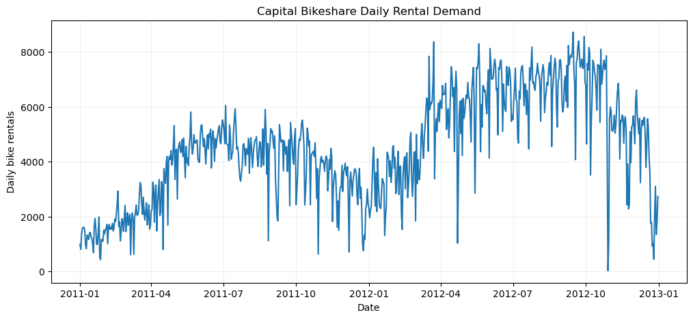

#My Data Science Portfolio

## About Me

Hello! My name is **QIYUE**. I am an undergraduate student interested in data analysis, data visualization, and machine learning.

## Technical Skills

- Python
- pandas and NumPy
- Matplotlib
- scikit-learn
- Jupyter Notebook
- Git and GitHub

## Featured Project: Weather and Bike-Sharing Demand

**Combined 731 daily bike-rental records with NOAA weather data; all 731 dates matched, and temperature was positively correlated with rentals (r ≈ 0.628).**

**Research question:** How are daily bike-sharing rentals associated with weather conditions in the Washington, D.C. area?

The notebook combines 731 daily bike-rental observations from 2011–2012 with NOAA daily weather observations. In the saved analysis, all 731 dates matched, and the correlation between NOAA daily temperature and rentals was approximately 0.628. This is an association, not proof that temperature alone causes changes in demand.

**Project repository:** [View the code, documentation, and visualizations](https://github.com/ds502-spec/data-science-project)

**Project status:** Ongoing — the initial feasibility analysis is complete.

## What I Will Improve Next

I plan to improve the validation strategy, explain model evaluation results more clearly, and investigate whether the patterns generalize to other periods or locations.
